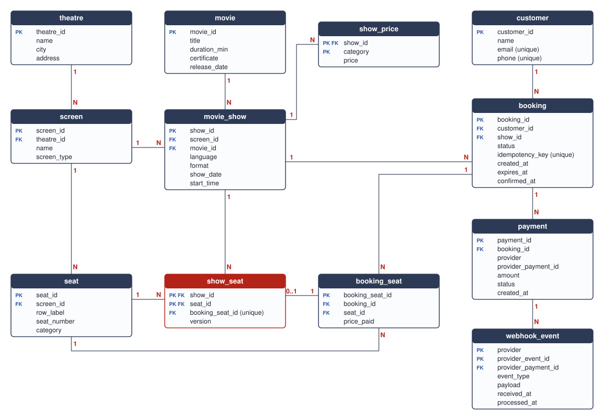

# High-Concurrency Booking Engine

A MySQL data model for a BookMyShow-style ticketing platform: **P1** (entities, tables, normalization, sample data, locking strategy) and **P2** (shows at a theatre on a date).

Everything marked *implemented* is SQL in this repository and was run on MySQL 8.4.13. Everything marked *design only* (Redis, queues, load test) is a written design that has not been built.

## 1. Scope and assumptions

The flow: a user opens a theatre, picks one of the next 7 dates, sees the movies with their show timings, picks seats, holds them for 10 minutes, and pays. The payment provider reports the result through a webhook.

| # | Assumption |
|---|---|
| 1 | The user starts from a known theatre. City search is out of scope. |
| 2 | A seat's category (Silver, Gold, Recliner) is set **per seat**. One row may mix categories (row B in the sample data does). |
| 3 | Price depends on the show and the seat category. A single currency (INR) is used. |
| 4 | `address` is a free-text street line. It does not determine the city. |
| 5 | `show_date` and `start_time` are the theatre's local time. |
| 6 | The application verifies the webhook signature before calling the database. |
| 7 | A booking covers one show and 1 to 10 seats. |

## 2. Entities and relationships



| Entity (table) | What it represents | Main relationships |
|---|---|---|
| `theatre` | A cinema building | has many screens |
| `screen` | An auditorium in a theatre | has many seats and shows |
| `seat` | A physical seat in a screen | appears once in the inventory of each show on its screen |
| `movie` | A film | screened in many shows |
| `movie_show` | One screening: movie, screen, date, time, language, format | has prices, inventory and bookings |
| `show_price` | Price of a seat category for a show | belongs to a show |
| `customer` | A person who books | makes many bookings |
| `booking` | One checkout attempt; while `PENDING` it is a timed hold | has seats and payments |
| `booking_seat` | A seat requested by a booking, with its price | may currently own one inventory row |
| `show_seat` | Live inventory of one seat for one show. **The row that gets locked** | points to the booking seat that owns it |
| `payment` | One payment attempt at a provider | has many webhook events |
| `webhook_event` | One event delivered by a provider | refers to a payment |

## 3. Why these 12 tables

### 3.1 The test every table must pass

A table is kept only if it meets at least one of these:

- **E (entity):** it has its own identity and lifecycle.
- **N (normal form):** without it some dependency breaks 2NF, 3NF or BCNF.
- **C (concurrency):** it carries a guarantee the brief asks for: no double booking, timed holds that are not lost, idempotent webhooks.

A lookup table for a single value (city name, language, format, category) is **not required by any normal form**: a column value is not a functional dependency. Where the set of values is small and stable, `ENUM` or `CHECK` gives the same validation without a join.

### 3.2 Candidate table lists

| Variation | Tables |
|---|---|
| **V1 Bare minimum (7)** | theatre, screen, movie, movie_show, customer, booking, booking_seat |
| **V2 Lean (9)** | V1 without booking_seat, plus seat, show_seat, payment |
| **V3 Chosen (12)** | V2 plus show_price, booking_seat, webhook_event |
| **V4 Full lookups (17)** | V3 plus city, seat_category, language, format, movie_language |

| Requirement | V1 | V2 | **V3** | V4 |
|---|---|---|---|---|
| List shows by date with timings | Yes | Yes | **Yes** | Yes, with more joins |
| Seats validated against a real layout | No, free text | Yes | **Yes** | Yes |
| No double booking | Only by copying `show_id` into booking_seat | Yes | **Yes** | Yes |
| Price per seat category | No | No | **Yes** | Yes |
| Expired or cancelled bookings remember their seats | Only if rows are never deleted, which blocks resale | No | **Yes** | Yes |
| Webhook de-duplication and audit | No | Status checks only | **Yes** | Yes |
| BCNF | No | No | **Yes** | Yes |
| Tables that pass none of E, N, C | 0 | 0 | **0** | 5 |

**V1 is too small.** Without a seat inventory, the only way to stop double booking is `UNIQUE(show_id, seat_label)` on booking_seat. That needs `show_id` in booking_seat although the booking already determines it (`booking_id -> show_id`), which breaks BCNF. The unique key also blocks resale after an expiry unless history is deleted. There is nowhere to record payments.

**V2 is still too small.** Dropping booking_seat leaves `show_seat.booking_id` as the only link between a booking and its seats. In that table `booking_id -> show_id` holds while `booking_id` is not a key, so it is in 3NF but **not BCNF**. When a hold expires the link is cleared and the booking no longer knows what it held, so a late payment cannot be honoured. There is one price per show and no event de-duplication.

**V4 is too big.** All five extra tables are single-value lookups. They add joins to the theatre page, which is the most frequent read, and remove no redundancy that `ENUM` or `CHECK` leaves behind. Add them when a feature needs them: `city` for city selection with state or time zone, `language` and `seat_category` when administrators must manage the lists at run time.

**V3 is the smallest list that meets every requirement and stays in BCNF.**

### 3.3 Justification of each table

| Table | Test | Why it cannot be merged away |
|---|---|---|
| theatre | E | Starting point of the user flow. `city` stays a column. |
| screen | E | Seats belong to a physical screen. Merging into theatre would repeat theatre data per screen. |
| seat | E | The fixed layout, defined once instead of once per show. |
| movie | E | Shared by many shows. Duration and certificate depend only on the movie. |
| movie_show | E | One screening; the thing the P2 query lists. |
| show_price | N | Price is a fact about *(show, category)*. On show_seat it would repeat on every seat of the category, and storing the category beside it creates a transitive dependency. As three price columns on movie_show it is a repeating group that needs `ALTER TABLE` for a new category. |
| customer | E | Owns bookings. |
| booking | E, C | Carries the hold timer (`expires_at`), the lifecycle status and the client's idempotency key. |
| booking_seat | N, C | Permanent record of seats and price paid. Adding `show_id` here would break 2NF, because `booking_id` alone determines it. |
| show_seat | C | One pre-created row per (show, seat) gives every competing transaction the same row to lock. |
| payment | E | A booking can have several attempts (fail, retry, succeed), so these cannot be columns of booking. |
| webhook_event | C | The primary key on the provider's event id rejects repeat deliveries, including ones that change no status, and keeps the raw payload. |

### 3.4 Design choices inside the table list

**How should show_seat point at its owner?**

| Option | Result |
|---|---|
| A `status` column (`FREE`, `HELD`, `BOOKED`) | Duplicates `booking.status`; the two can disagree. Rejected. |
| `booking_id` | Simple, but `booking_id -> show_id` makes the table fail BCNF. Rejected. |
| **`booking_seat_id`, unique** | The determinant is a key of the table, so it is in BCNF. A composite foreign key also proves that the owner is for the same seat. **Chosen.** |

The cost of the chosen option is one extra join to read a seat's status, and one rule the schema cannot declare: the owner's booking must be for the same show. The procedures guarantee it and an invariant query checks it.

**Why create inventory rows in advance?** The alternative inserts a row only when a seat is taken and relies on a unique key. It saves space, but there is no row to lock beforehand, `SKIP LOCKED` cannot pick free seats, and counting free seats needs an anti-join. Pre-created rows cost storage (seats x shows), which is handled by archiving past shows.

## 4. Table structures and sample rows

Sample rows are query output from `02_seed.sql`. Dates are relative to the day the script runs (here 2026-11-27). Types such as `INT UNSIGNED` are abbreviated to `INT`; exact definitions are in the P1 SQL.

### 4.1 theatre

| Column | Type | Constraints |
|---|---|---|
| theatre_id | INT | PK, auto increment |
| name | VARCHAR(100) | NOT NULL, unique with city |
| city | VARCHAR(60) | NOT NULL |
| address | VARCHAR(255) | NOT NULL |

| theatre_id | name | city | address |
|---|---|---|---|
| 1 | Aurora Cineplex | Bengaluru | 12 Lake View Road, Indiranagar |
| 2 | Meridian Talkies | Mumbai | 48 Harbour Street, Andheri West |

### 4.2 screen

| Column | Type | Constraints |
|---|---|---|
| screen_id | INT | PK, auto increment |
| theatre_id | INT | FK theatre |
| name | VARCHAR(40) | unique with theatre_id |
| screen_type | ENUM | STANDARD, DOLBY_ATMOS, IMAX |

| screen_id | theatre_id | name | screen_type |
|---|---|---|---|
| 1 | 1 | Screen 1 | DOLBY_ATMOS |
| 2 | 1 | Screen 2 | IMAX |
| 3 | 2 | Screen 1 | STANDARD |

### 4.3 seat

| Column | Type | Constraints |
|---|---|---|
| seat_id | INT | PK, auto increment |
| screen_id | INT | FK screen |
| row_label | VARCHAR(3) | unique with screen_id, seat_number |
| seat_number | SMALLINT | greater than 0 |
| category | ENUM | SILVER, GOLD, RECLINER |

| seat_id | screen_id | row_label | seat_number | category |
|---|---|---|---|---|
| 1 | 1 | A | 1 | SILVER |
| 7 | 1 | B | 1 | SILVER |
| 8 | 1 | B | 2 | GOLD |
| 13 | 1 | C | 1 | RECLINER |

### 4.4 movie

| Column | Type | Constraints |
|---|---|---|
| movie_id | INT | PK, auto increment |
| title | VARCHAR(150) | unique with release_date |
| duration_min | SMALLINT | greater than 0 |
| certificate | ENUM | U, UA, A |
| release_date | DATE | NOT NULL |

| movie_id | title | duration_min | certificate | release_date |
|---|---|---|---|---|
| 1 | The Last Monsoon | 142 | UA | 2026-11-13 |
| 2 | Orbit of Silence | 128 | UA | 2026-11-20 |
| 3 | Chai and Chaos | 118 | U | 2026-11-06 |
| 4 | Midnight Ledger | 135 | A | 2026-11-24 |

### 4.5 movie_show

| Column | Type | Constraints |
|---|---|---|
| show_id | INT | PK, auto increment |
| screen_id | INT | FK screen |
| movie_id | INT | FK movie |
| language | VARCHAR(20) | CHECK against a fixed list |
| format | ENUM | 2D, 3D, IMAX |
| show_date | DATE | unique with screen_id, start_time |
| start_time | TIME | NOT NULL |

| show_id | screen_id | movie_id | language | format | show_date | start_time |
|---|---|---|---|---|---|---|
| 1 | 1 | 1 | Hindi | 2D | 2026-11-27 | 09:30:00 |
| 2 | 1 | 3 | Hindi | 2D | 2026-11-27 | 13:15:00 |
| 3 | 1 | 1 | Hindi | 2D | 2026-11-27 | 17:00:00 |
| 4 | 1 | 4 | English | 2D | 2026-11-27 | 20:45:00 |
| 5 | 2 | 2 | English | IMAX | 2026-11-27 | 10:00:00 |

### 4.6 show_price

| Column | Type | Constraints |
|---|---|---|
| show_id | INT | PK, FK movie_show |
| category | ENUM | PK |
| price | DECIMAL(8,2) | 0 or more |

| show_id | category | price |
|---|---|---|
| 3 | SILVER | 220.00 |
| 3 | GOLD | 290.00 |
| 3 | RECLINER | 490.00 |
| 5 | SILVER | 330.00 |

### 4.7 customer

| Column | Type | Constraints |
|---|---|---|
| customer_id | BIGINT | PK, auto increment |
| name | VARCHAR(100) | NOT NULL |
| email | VARCHAR(150) | unique |
| phone | VARCHAR(20) | unique |

| customer_id | name | email | phone |
|---|---|---|---|
| 1 | Asha Rao | asha.rao@example.com | +91-90000-00001 |
| 2 | Vikram Shah | vikram.shah@example.com | +91-90000-00002 |
| 3 | Neha Iyer | neha.iyer@example.com | +91-90000-00003 |

### 4.8 booking

| Column | Type | Constraints |
|---|---|---|
| booking_id | BIGINT | PK, auto increment |
| customer_id | BIGINT | FK customer |
| show_id | INT | FK movie_show |
| status | ENUM | PENDING, CONFIRMED, EXPIRED, CANCELLED |
| idempotency_key | CHAR(36) | unique |
| created_at | DATETIME(3) | default now |
| expires_at | DATETIME(3) | end of the hold |
| confirmed_at | DATETIME(3) | NULL until confirmed |

| booking_id | customer_id | show_id | status | idempotency_key (ending) | expires_at | confirmed_at |
|---|---|---|---|---|---|---|
| 1 | 1 | 3 | CONFIRMED | ...000000000001 | 12:30:43 | 12:23:43 |
| 2 | 2 | 3 | PENDING | ...000000000002 | 13:30:43 | NULL |
| 3 | 3 | 3 | EXPIRED | ...000000000003 | 13:00:43 | NULL |

### 4.9 booking_seat

| Column | Type | Constraints |
|---|---|---|
| booking_seat_id | BIGINT | PK, auto increment |
| booking_id | BIGINT | FK booking, unique with seat_id |
| seat_id | INT | FK seat |
| price_paid | DECIMAL(8,2) | price at the time of booking |

| booking_seat_id | booking_id | seat_id | price_paid |
|---|---|---|---|
| 1 | 1 | 8 | 290.00 |
| 2 | 1 | 9 | 290.00 |
| 3 | 2 | 13 | 490.00 |
| 4 | 2 | 14 | 490.00 |
| 5 | 3 | 1 | 220.00 |

### 4.10 show_seat

| Column | Type | Constraints |
|---|---|---|
| show_id | INT | PK, FK movie_show |
| seat_id | INT | PK, FK seat |
| booking_seat_id | BIGINT | NULL = free; unique; FK (booking_seat_id, seat_id) to booking_seat |
| version | INT | incremented on every change of owner |

| show_id | seat_id | booking_seat_id | version | Meaning |
|---|---|---|---|---|
| 3 | 1 | NULL | 0 | free (booking 3 expired) |
| 3 | 8 | 1 | 1 | booked (booking 1) |
| 3 | 9 | 2 | 1 | booked (booking 1) |
| 3 | 10 | NULL | 0 | free |
| 3 | 13 | 3 | 1 | held (booking 2) |

### 4.11 payment

| Column | Type | Constraints |
|---|---|---|
| payment_id | BIGINT | PK, auto increment |
| booking_id | BIGINT | FK booking |
| provider | VARCHAR(30) | unique with provider_payment_id |
| provider_payment_id | VARCHAR(100) | the provider's reference |
| amount | DECIMAL(10,2) | amount the provider reported |
| status | ENUM | INITIATED, SUCCEEDED, FAILED, REFUND_PENDING, REFUNDED |
| created_at | DATETIME(3) | default now |

| payment_id | booking_id | provider | provider_payment_id | amount | status |
|---|---|---|---|---|---|
| 1 | 1 | demopay | pay_0001 | 580.00 | SUCCEEDED |
| 2 | 3 | demopay | pay_0002 | 220.00 | FAILED |

### 4.12 webhook_event

| Column | Type | Constraints |
|---|---|---|
| provider | VARCHAR(30) | PK |
| provider_event_id | VARCHAR(100) | PK |
| provider_payment_id | VARCHAR(100) | FK (provider, provider_payment_id) to payment |
| event_type | VARCHAR(50) | NOT NULL |
| payload | JSON | raw message, for audit |
| received_at | DATETIME(3) | default now |
| processed_at | DATETIME(3) | set when applied |

| provider | provider_event_id | provider_payment_id | event_type | payload |
|---|---|---|---|---|
| demopay | evt_0001 | pay_0001 | payment.succeeded | {"booking_id": 1, ...} |
| demopay | evt_0002 | pay_0002 | payment.failed | {"booking_id": 3, ...} |

## 5. Normalization

**1NF.** Every column holds one value and every table has a primary key. Seats of a booking and prices of a show are rows, not lists or repeated columns. `webhook_event.payload` is stored as one opaque audit document; no logic reads its parts.

**2NF.** No non-key column depends on part of a candidate key. The composite keys are checked here: `show_price.price` needs both show and category; `booking_seat.price_paid` needs both booking and seat; `seat.category` needs screen, row and number; `show_seat.version` needs show and seat.

**3NF and BCNF.** In every table, the left side of every non-trivial functional dependency is a candidate key.

| Table | Candidate keys | Functional dependencies | BCNF |
|---|---|---|---|
| theatre | theatre_id; (city, name) | key -> address and the other key | Yes |
| screen | screen_id; (theatre_id, name) | key -> screen_type | Yes |
| seat | seat_id; (screen_id, row_label, seat_number) | key -> category | Yes |
| movie | movie_id; (title, release_date) | key -> duration_min, certificate | Yes |
| movie_show | show_id; (screen_id, show_date, start_time) | key -> movie_id, language, format | Yes |
| show_price | (show_id, category) | key -> price | Yes |
| customer | customer_id; email; phone | key -> name | Yes |
| booking | booking_id; idempotency_key | key -> customer_id, show_id, status, times | Yes |
| booking_seat | booking_seat_id; (booking_id, seat_id) | key -> price_paid | Yes |
| show_seat | (show_id, seat_id); booking_seat_id when not NULL | key -> version, owner | Yes |
| payment | payment_id; (provider, provider_payment_id) | key -> booking_id, amount, status | Yes |
| webhook_event | (provider, provider_event_id) | key -> provider_payment_id, event_type, payload, times | Yes |

Dependencies that look possible but do not hold:

- `payment.booking_id -> amount` does not hold: the column records what the provider reported, which can differ between attempts (a wrong amount is stored and marked for refund).
- `movie_show.movie_id -> language` or `format` does not hold: one movie runs in several versions.
- `movie_show.screen_id -> format` does not hold: the IMAX screen also shows 2D.

**Values deliberately not stored**

| Not stored | Derived from | Problem if stored |
|---|---|---|
| theatre_id on movie_show | screen.theatre_id | transitive dependency (3NF) |
| end_time on movie_show | start_time + movie.duration_min | depends on non-key columns (3NF) |
| total_seats on screen | COUNT of seat | redundant, can drift |
| total amount on booking | SUM of booking_seat.price_paid | redundant, can drift |
| seat status on show_seat | owner and booking.status | redundant, can disagree |
| hold expiry on show_seat | booking.expires_at | one fact repeated per seat |

## 6. Concurrency and locking strategy

### 6.1 Booking lifecycle

| From | Event | To | Inventory |
|---|---|---|---|
| (new) | hold succeeds | PENDING | seats claimed for 10 minutes |
| PENDING | payment succeeds | CONFIRMED | unchanged |
| PENDING | timer runs out | EXPIRED | seats released |
| EXPIRED | late payment, all seats still free | CONFIRMED | seats claimed again |
| EXPIRED | late payment, a seat resold | EXPIRED, payment REFUND_PENDING | unchanged |
| CONFIRMED | paying charge refunded | CANCELLED | seats released |

### 6.2 Two layers

```
Client -> [queue / rate limit]* -> [Redis seat gate]* -> MySQL transaction -> payment provider
                                                             ^                      |
                                     expiry sweeper ---------+------- webhook <-----+
* design only
```

MySQL is the source of truth. Redis only reduces how much contention reaches it, so a Redis failure can slow the system but cannot cause a double booking.

### 6.3 Redis seat gate (design only)

Before the database call, the service takes all requested seats atomically with a Lua script. The `{showId}` hash tag keeps the keys of one show in one cluster slot.

```lua
-- KEYS: hold:{showId}:seatId ...   ARGV[1]: idempotency key   ARGV[2]: TTL in ms
for _, k in ipairs(KEYS) do
  local owner = redis.call('GET', k)
  if owner and owner ~= ARGV[1] then return 0 end
end
for _, k in ipairs(KEYS) do
  redis.call('SET', k, ARGV[1], 'PX', ARGV[2])
end
return 1
```

- TTL is 600000 ms, matching `expires_at`, so a crashed service cannot block a seat for ever.
- If the MySQL hold fails, the service deletes its keys, but only those whose value is still its own key (compare and delete in Lua).
- Cancellation deletes the keys. After confirmation they may simply expire: MySQL rejects later attempts.

### 6.4 Taking a hold (implemented: `sp_hold_seats`)

In one `READ COMMITTED` transaction: insert the booking, insert its booking_seat rows with current prices, then claim the inventory:

```sql
UPDATE booking_seat bs
STRAIGHT_JOIN show_seat ss
       ON ss.show_id = p_show_id AND ss.seat_id = bs.seat_id
SET ss.booking_seat_id = bs.booking_seat_id,
    ss.version         = ss.version + 1
WHERE bs.booking_id = p_booking_id
  AND ss.booking_seat_id IS NULL;
```

If the number of rows changed differs from the number of seats requested, the whole transaction rolls back: all seats or none.

**Why this cannot double book:** `(show_id, seat_id)` is the primary key, so there is exactly one row per seat per show. The update takes an exclusive row lock on it and tests "is it free" under that lock. A second transaction waits, then sees the committed owner and changes nothing.

**Deadlocks:** rows are locked in seat order, so two holds on overlapping seats queue instead of waiting on each other. The application still retries error 1213.

**Client retries:** the unique `idempotency_key` makes a repeated request return the original booking.

### 6.5 Pessimistic or optimistic?

| Strategy | How it works | Under heavy contention | Verdict |
|---|---|---|---|
| Pessimistic: `SELECT ... FOR UPDATE`, then update | Lock first, decide in code | Waiters queue; locks stay held across round trips | Correct but holds locks longer |
| `FOR UPDATE NOWAIT` / `SKIP LOCKED` | Fail at once, or skip locked rows | No queueing; losers must retry | NOWAIT for fail-fast clicks; SKIP LOCKED for "any N seats" and the sweeper |
| Optimistic: read `version`, `UPDATE ... WHERE version = ?` | No lock while reading | Many retries on popular seats | Good when conflicts are rare |
| **Conditional update (chosen)** | One compare-and-set statement | Short lock; losers learn the result immediately after the winner commits | No gap between read and write, no extra round trip |
| Redis only | Keys with TTL | Very fast | A failover can lose holds, so it cannot be the record |

The chosen statement is optimistic in style (no earlier read lock) while InnoDB's row lock serialises the write. `version` is not needed for its correctness; it lets a cached seat map detect that a row changed. The seat lock lasts only for the short hold transaction. During the 10 minutes of payment **no database lock is held**: the hold is ordinary data.

### 6.6 Timed release (implemented: `sp_expire_holds`, `ev_expire_holds`)

A MySQL event runs every 30 seconds. It selects `PENDING` bookings past `expires_at` with `FOR UPDATE SKIP LOCKED`, frees their seats and marks them `EXPIRED`. Several workers can run it safely. A seat can stay unavailable up to 30 seconds after the timer ends. At production scale, run it from application workers every few seconds and repeat until a batch comes back empty.

**Why no hold is lost:** the hold is a committed row, so it survives restarts (with `innodb_flush_log_at_trx_commit = 1`, the default). Expiry is derived from stored data, not from a timer in memory. booking_seat is never deleted, so every booking still knows its seats.

### 6.7 Idempotent webhooks (implemented: `sp_payment_webhook`)

1. Insert into `webhook_event`. A duplicate key means the event was already handled: return success without changes. A simultaneous duplicate waits for the first transaction, then gets the same error.
2. Lock the booking row, which serialises the webhook against the sweeper.
3. Find or create the payment on `(provider, provider_payment_id)`.
4. Apply the event. Statuses only move forward, so late or reordered events do no harm.
5. Commit. A crash before this leaves no trace, and the provider's retry is processed normally.

| Situation | Result |
|---|---|
| Success, booking pending | CONFIRMED |
| Success, hold expired, seats free | CONFIRMED_LATE |
| Success, hold expired, seat resold | REFUND_REQUIRED |
| Success, booking already confirmed by another charge, or cancelled | REFUND_REQUIRED |
| Success with the wrong amount | AMOUNT_MISMATCH (marked for refund) |
| Same event id again | DUPLICATE_EVENT |
| New event id for an already applied payment | ALREADY_APPLIED |
| Failure | PAYMENT_FAILED; the hold stays so the customer can retry |
| Refund of the paying charge | REFUNDED; booking cancelled, seats freed |
| Unknown booking | UNKNOWN_BOOKING; nothing recorded, so a retry is possible |

`REFUND_PENDING` rows are the work list for a refund job, which is outside this assignment.

## 7. Performance at scale

### 7.1 Indexes by query

| Query | Index used |
|---|---|
| Screens of a theatre | `uq_screen_theatre_name (theatre_id, name)` |
| Shows of a screen on a date, by time | `uq_show_slot (screen_id, show_date, start_time)` |
| Claim seats | primary key `show_seat (show_id, seat_id)` |
| Release a booking's seats | `uq_booking_seat`, then `uq_show_seat_owner` |
| Find expired holds | `idx_booking_expiry (status, expires_at)` |
| Webhook de-duplication | primary key of `webhook_event` |
| Find a payment | `uq_payment_provider_ref` |

`EXPLAIN` confirms these paths (section 9).

### 7.2 Growth and burst handling (design only)

- **Read load:** cache the theatre page per (theatre, date) for a few seconds and serve it from read replicas. Holds and webhooks always use the primary.
- **Inventory size:** for example 1,000 screens x 5 shows x 200 seats is 1 million `show_seat` rows per day. Archive finished shows to keep the live tables small.
- **Bursts:** for a blockbuster release, place a virtual waiting room in front of the hold API. A queue admits users at the rate the database sustains per show, and rejects early when a show is sold out.
- **Back pressure:** bounded connection pools, per-user rate limits, a short `innodb_lock_wait_timeout`, and retry with jitter.

### 7.3 Load test plan (design only, not run)

Tool: k6 against an API built on these procedures, with production-like data volume.

| Scenario | Load | Pass criteria (proposed targets) |
|---|---|---|
| Browse theatre pages | steady 2,000 requests/s | p95 under 200 ms |
| Spike on one show | 0 to 5,000 users in 10 s, random 2-seat holds | no seat owned twice; p95 under 500 ms; no 5xx |
| Same seat | 1,000 users, one seat | exactly one success |
| Webhook storm | each event sent 10 times, out of order | one state change per event |
| Abandonment | 70% of holds never paid | all released within expiry + 30 s |
| Kill an app node and Redis during the spike | fault injection | invariants still hold |

After every run these must return zero rows: a seat in two active bookings; an active booking missing a seat; an inactive booking still owning a seat; a `SUCCEEDED` payment whose booking is not `CONFIRMED`.

## 8. P2: shows on a date at a theatre

Set the theatre and date, then run `sql/03_p2_shows_by_date.sql`.

```sql
SELECT m.title AS movie, m.certificate, ms.language, ms.format,
       GROUP_CONCAT(TIME_FORMAT(ms.start_time, '%h:%i %p')
                    ORDER BY ms.start_time SEPARATOR ', ') AS show_timings
FROM screen sc
JOIN movie_show ms ON ms.screen_id = sc.screen_id
                  AND ms.show_date = @show_date
JOIN movie      m  ON m.movie_id   = ms.movie_id
WHERE sc.theatre_id = @theatre_id
GROUP BY m.movie_id, m.title, m.certificate, ms.language, ms.format
ORDER BY m.title, ms.language, ms.format;
```

Output for theatre 1 (Aurora Cineplex), 2026-11-27:

| movie | certificate | language | format | show_timings |
|---|---|---|---|---|
| Chai and Chaos | U | Hindi | 2D | 01:15 PM |
| Midnight Ledger | A | English | 2D | 08:45 PM |
| Orbit of Silence | UA | English | IMAX | 10:00 AM, 06:30 PM |
| Orbit of Silence | UA | Hindi | 3D | 02:00 PM |
| The Last Monsoon | UA | Hindi | 2D | 09:30 AM, 05:00 PM, 09:15 PM |

The same script also returns one row per show, with screen, end time and seats available:

| movie | language | format | screen | start | end | seats available |
|---|---|---|---|---|---|---|
| Chai and Chaos | Hindi | 2D | Screen 1 | 01:15 PM | 03:13 PM | 18 |
| Midnight Ledger | English | 2D | Screen 1 | 08:45 PM | 11:00 PM | 18 |
| Orbit of Silence | English | IMAX | Screen 2 | 10:00 AM | 12:08 PM | 18 |
| Orbit of Silence | English | IMAX | Screen 2 | 06:30 PM | 08:38 PM | 18 |
| Orbit of Silence | Hindi | 3D | Screen 2 | 02:00 PM | 04:08 PM | 18 |
| The Last Monsoon | Hindi | 2D | Screen 1 | 09:30 AM | 11:52 AM | 18 |
| The Last Monsoon | Hindi | 2D | Screen 1 | 05:00 PM | 07:22 PM | 14 |
| The Last Monsoon | Hindi | 2D | Screen 2 | 09:15 PM | 11:37 PM | 18 |

A third query lists the dates, among today and the next 6 days, that have shows (the date picker).

## 9. Verification

Run on MySQL 8.4.13 in Docker. The four SQL files run in order without errors, including with `sql_safe_updates` on. The concurrency checks used parallel `mysql` clients. They are small functional checks, not a load test.

| Check | Result |
|---|---|
| Second session wants a seat while the first transaction is open | waited for the commit, then SEATS_UNAVAILABLE |
| `FOR UPDATE NOWAIT` on that locked row | failed at once with error 3572 |
| 100 parallel 2-seat holds on 18 seats | 8 held, 92 rejected; 16 seats claimed; none owned twice |
| 100 parallel holds on one seat | 1 held, 99 rejected |
| One webhook delivered 30 times in parallel | 1 CONFIRMED, 29 DUPLICATE_EVENT; 1 payment row |
| Payment racing the expiry sweeper, 18 trials | 5 CONFIRMED, 13 CONFIRMED_LATE; every paid booking kept its seat |
| Refund, failure, wrong amount, reused key and other branches | results as in section 6.7 |
| Invariants after all tests | 0 violations |
| Deadlocks during all tests | 0 |

`EXPLAIN` of the P2 query (no full scan; `movie_show` is reached through its slot index):

| table | type | key | rows |
|---|---|---|---|
| sc | ref | uq_screen_theatre_name | 2 |
| ms | ref | uq_show_slot | 3 |
| m | eq_ref | PRIMARY | 1 |

The sweeper's search uses `idx_booking_expiry` (range), and the seat claim reaches `show_seat` by primary key (eq_ref).

## 10. Limitations

- The schema does not prevent two shows on one screen from overlapping; only identical start times are rejected. A trigger or scheduling service should check this.
- "A claim belongs to the same show as its booking" is enforced by the procedures, not by a constraint (section 3.4). Application accounts should be allowed to execute the procedures only, not to write these tables.
- A show's inventory is created by the seed script; a real system needs a procedure run when a show is published.
- Redis, the waiting room, the refund job and the load test are designs only.
